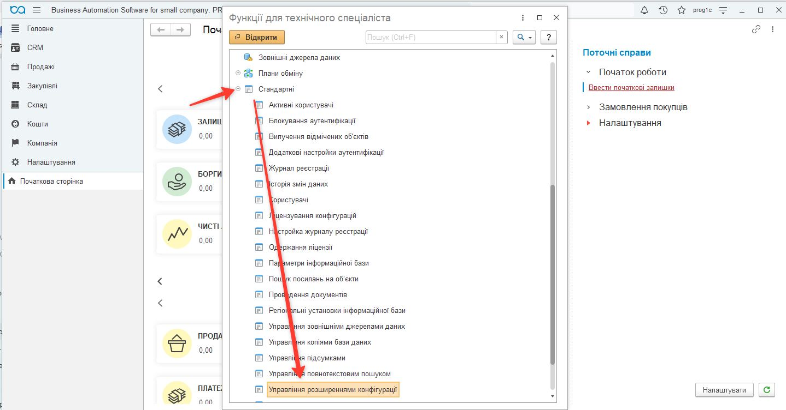
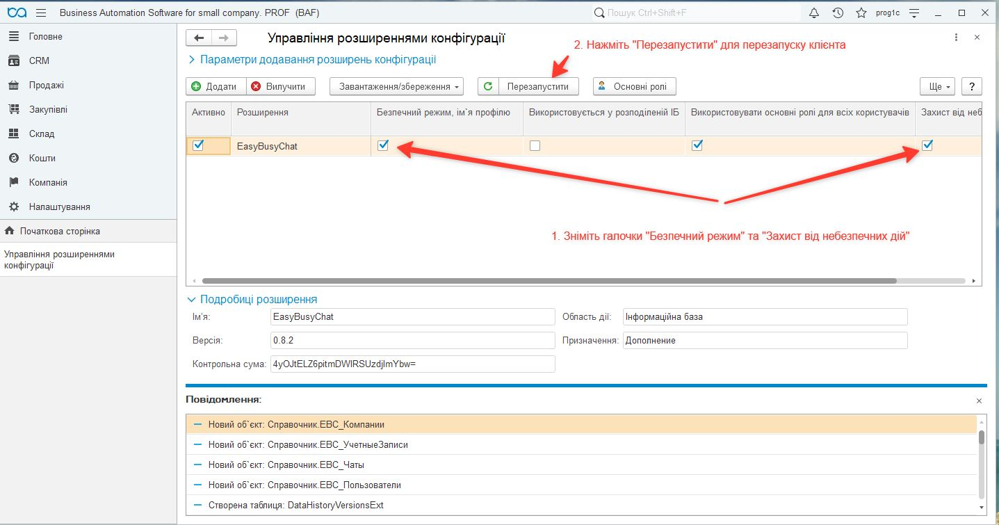
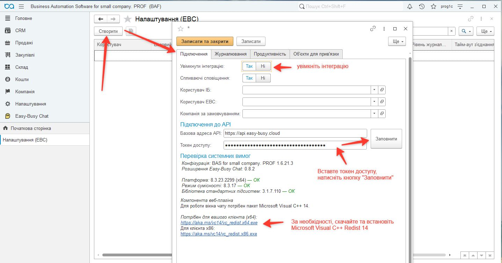
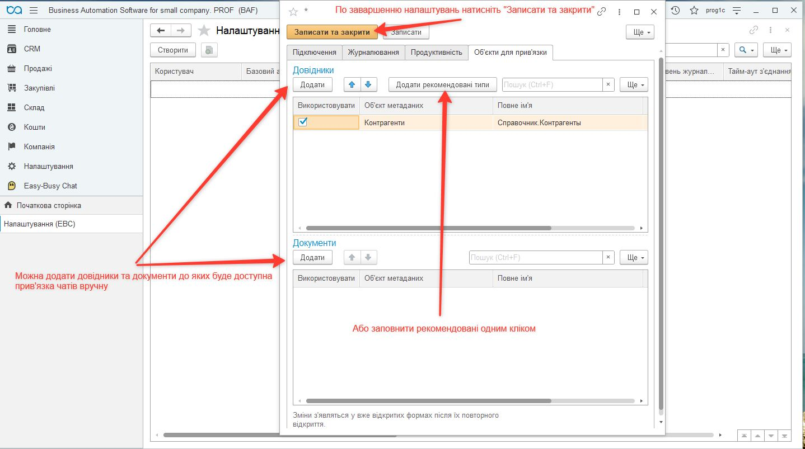
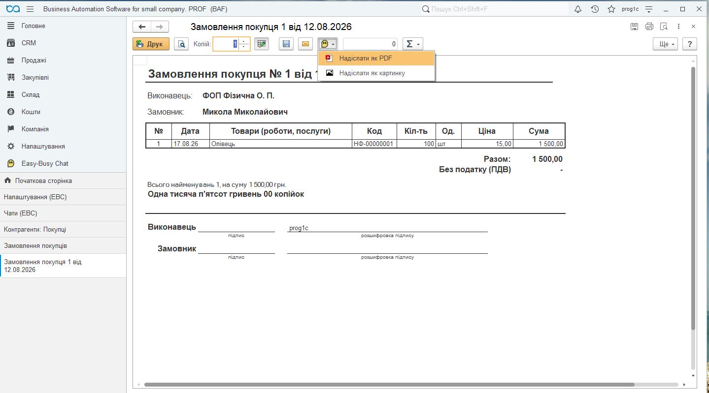

[**Українська**](README.md) · [Русский](README_ru.md)

  

# Easy Busy Chat для BAS / BAF

Розширення інтегрує конфігурації 1С/BAF (BAS) із сервісом **Easy-Busy Chats** без зміни основної конфігурації. Воно допомагає працювати з листуванням із месенджерів у контексті клієнтів і документів облікової бази.

Цей документ описує вибір розширення, встановлення, налаштування та щоденну роботу. Репозиторій містить готові CFE-розширення, додаткову EPF-обробку, ZIP-комплекти й документацію.

## Зміст

- [Можливості](#capabilities)
- [Завантажити та обрати варіант](#downloads)
- [Системні вимоги](#requirements)
- [Встановлення](#installation)
- [Початкове налаштування](#setup)
- [Робота з чатами](#usage)
- [Фонові завдання для 8.3.19](#scheduler)
- [Оновлення розширення](#updating)
- [Перевірка налаштування](#verification)
- [Вирішення проблем](#troubleshooting)
- [Склад репозиторію](#repository)

## Можливості

- Синхронізація компаній, облікових записів, користувачів і чатів Easy-Busy Chats.
- Зв’язування чатів із довідниками та документами інформаційної бази.
- Відкриття вебчату, надсилання текстових повідомлень і друкованих форм як PDF або зображення.
- Пошук чатів за міжнародним номером телефону та створення чатів Viber, WhatsApp і Telegram, якщо це дозволяє обліковий запис.
- Вибір мови чату, журналювання дій користувачів і технічних подій інтеграції.
- Робоче місце «Контакт-центр» у варіантах EasyBusyChat для BAS Малий бізнес.
- Регламентна синхронізація та очищення журналу; для окремого варіанта 8.3.19 — через додаткову обробку БСП.

Доступні канали й можливість розпочати листування залежать від провайдера та прав облікового запису. Прийняття повідомлення сервісом не є підтвердженням доставки одержувачу.

## Завантажити та обрати варіант

Перевірте конфігурацію та версію платформи в меню «Про програму». Встановлюйте **один** із трьох альтернативних варіантів CFE.

| Варіант | Коли обирати | Завантаження |
|---|---|---|
| **EasyBusyChat** | BAS Малий бізнес 1.6 / 2.0 на платформі новішій за 8.3.19; включає «Контакт-центр» | [ZIP з інструкцією](releases/2026-11-02/EasyBusyChat_v0.10.5.zip?raw=1) · [CFE](releases/2026-11-02/EasyBusyChat_v0.10.5.cfe?raw=1) |
| **EasyBusyChat 8.3.19** | BAS Малий бізнес 1.6 / 2.0 на платформі 8.3.19; включає «Контакт-центр»; обов’язковий комплект **CFE + EPF** | [ZIP-комплект](releases/2026-11-02/EasyBusyChat_8.3.19_v0.10.4.zip?raw=1) · [CFE](releases/2026-11-02/EasyBusyChat_8.3.19_v0.10.4.cfe?raw=1) · [EPF](releases/2026-11-02/EasyBusyChatScheduler8319.epf?raw=1) |
| **EasyBusyChat Universal** | Базова інтеграція без «Контакт-центру» для підтримуваних конфігурацій на новішій за 8.3.19 платформі | [ZIP з інструкцією](releases/2026-11-02/EasyBusyChatUniversal_v0.10.4.zip?raw=1) · [CFE](releases/2026-11-02/EasyBusyChatUniversal_v0.10.4.cfe?raw=1) |

**Підтримувані конфігурації:**

| Конфігурація | EasyBusyChat / EasyBusyChat 8.3.19 | Universal |
|---|---|---|
| BAS Малий бізнес 1.6 / 2.0 | Так | Так |
| BAS Управління торгівлею 3.5 | — | Так |
| BAS Комплексне управління підприємством 3.5 | — | Так |
| BAS ERP 2.5 | — | Так |

ZIP потрібно розпакувати перед встановленням. Кожен архів містить CFE, інструкцію українською та контрольні суми SHA-256. Комплект 8.3.19 додатково містить EPF і її інструкцію. [Контрольні суми файлів](releases/2026-11-02/SHA256SUMS.txt).

Для BAS Малий бізнес на платформі 8.3.19 обирайте саме комплект 8.3.19 і налаштуйте [фонові завдання БСП](#scheduler). Назва цього варіанта позначає платформу, а не режим сумісності розширення.

## Системні вимоги

| Компонент | Вимога |
|---|---|
| Платформа 1С/BAF | 8.3.19.1529 або новіша, з урахуванням вибору варіанта вище |
| Бібліотека стандартних підсистем (БСП) | 3.1 або новіша |
| Режим сумісності EasyBusyChat та варіанта 8.3.19 | 8.3.17 |
| Режим сумісності Universal | 8.3.14 |
| Вебкомпонента | Тонкий або товстий клієнт Windows x86/x64 |
| Середовище вебкомпоненти | Microsoft Edge WebView2 Runtime на робочому місці користувача |
| Мережа | HTTPS-доступ до API Easy-Busy Chats і пов’язаних вебресурсів |
| Доступ до сервісу | Адреса API, токен і права відповідного облікового запису |
| Встановлення | Адміністратор інформаційної бази або користувач із повними правами |

[Завантажити WebView2 Runtime із сайту Microsoft](https://developer.microsoft.com/en-us/microsoft-edge/webview2/#download-section). Використовуйте Evergreen Runtime; для встановлення без інтернету є Standalone Installer.

Окреме вікно вебчату призначене для Windows-клієнта. Розширення містить Native API-компоненти x86 і x64, архітектуру обирає платформа. У вебклієнті чат відкривається за посиланням у браузері. Роботу інших сценаріїв у конкретному клієнті й ОС потрібно перевірити у своїй базі.

## Встановлення

Назви команд залежать від редакції BAS і мови інтерфейсу. Наявні скриншоти допомагають знайти потрібні форми; їх вигляд може відрізнятися.

1. Зробіть резервну копію бази й спочатку перевірте встановлення в тестовій копії. Оберіть пакет за таблицею, розпакуйте ZIP та звірте контрольну суму.
2. Установіть WebView2 Runtime на робочих місцях Windows, де використовуватиметься вебплагін.
3. Увійдіть у базу в режимі «1С:Підприємство» з адміністративними правами. Відкрийте **Налаштування → Параметри** й увімкніть **«Режим технічного спеціаліста»**.
4. Відкрийте **Функції для технічного спеціаліста → Стандартні → Управління розширеннями конфігурації**.
5. Натисніть **«Додати»**, виберіть CFE та підтвердьте відкриття перевіреного файлу. Якщо після першого підтвердження розширення не з’явилося, повторіть додавання.
6. Для роботи зовнішньої Native API-компоненти у довіреного **CFE-розширення** зніміть прапорці **«Безпечний режим»** і **«Захист від небезпечних дій»**. Це дозвіл на запуск зовнішньої компоненти; він не є інструкцією вимикати безпечний режим EPF.
7. Перезапустіть клієнт. Призначте користувачам ролі Easy Busy Chat відповідно до їхніх обов’язків.
8. Виконайте початкове налаштування нижче. Для варіанта 8.3.19 додатково зареєструйте EPF та розклади БСП.

Якщо розширення вже встановлене, використовуйте [процедуру оновлення](#updating), а не додавання іншого варіанта.

## Початкове налаштування

### Підключення до сервісу

1. Відкрийте **Easy-Busy Chats → Адміністрування → Налаштування** й натисніть **«Створити»**.
2. Увімкніть інтеграцію. Укажіть базову адресу API, якщо вона не заповнена, та свій токен доступу.
3. Натисніть **«Оновити ідентифікатори»** під полем токена. Перевірте завантажені компанії, облікові записи та користувачів.
4. За потреби виберіть користувача інформаційної бази, користувача EBC й компанію за замовчуванням.
5. Оберіть мову чату, збережіть налаштування та повторно відкрийте чат. Команди «Відкрити контакт» і «Створити замовлення» використовують обрану мову.

Токен зберігайте в налаштуваннях бази. Не додавайте його до документації, повідомлень або скриншотів.

### Журналювання та права

На вкладці **«Журналювання»** увімкніть потрібні технічні події й дії користувачів, визначте мінімальний рівень та кількість днів зберігання записів. Строк зберігання погодьте з адміністратором.

Перевірте права користувачів на підсистему та потрібні операції. Не призначайте всім користувачам повні адміністративні права для звичайної роботи з чатами.

### Об’єкти для прив’язки

1. На вкладці **«Об’єкти для прив’язки»** додайте довідники й документи кнопкою **«Додати»** або **«Додати рекомендовані типи»**.
2. Для потрібних типів увімкніть **«Використовувати»**.
3. Натисніть **«Записати та закрити»** й повторно відкрийте форми об’єктів. Уже відкриті форми не підхоплюють команди автоматично.

## Робота з чатами

### Завантаження та пошук

Відкрийте **Easy-Busy Chats → Див. також → Чати**, натисніть **«Завантажити список»** і дочекайтеся завершення синхронізації.

Для пошуку за телефоном використовуйте міжнародний формат номера. Створення чату Viber, WhatsApp або Telegram доступне лише тоді, коли відповідний провайдер та обліковий запис дозволяють почати листування.

### Зв’язки з клієнтами та документами

У формах налаштованих довідників і документів з’являється підменю **Easy-Busy Chats**. Доступність команд залежить від контексту:

- **«Відкрити чат»** — перейти до листування.
- **«Прив’язані чати»** — переглянути, створити або змінити зв’язок об’єкта з чатом.
- **«Надіслати повідомлення»** — надіслати текст у вибраний чат.

Перевіряйте зв’язки об’єкта й одержувача перед надсиланням, особливо якщо до об’єкта прив’язано кілька чатів.

### Друковані форми

У попередньому перегляді друкованої форми використовуйте **«Надіслати як PDF»** або **«Надіслати як картинку»**. Переконайтеся, що обрано потрібний документ і чат.

### Контакт-центр

Варіанти EasyBusyChat для BAS Малий бізнес включають робоче місце **«Контакт-центр»**. Universal призначений для базової інтеграції без цього робочого місця. Доступ визначається встановленим варіантом і правами користувача.

## Фонові завдання для 8.3.19

Цей розділ стосується комплекту **EasyBusyChat 8.3.19 + EasyBusyChatScheduler8319.epf** для BAS Малий бізнес. EPF викликає серверні процедури розширення через БСП; окремої користувацької форми вона не має.

### Реєстрація обробки

1. Установіть CFE, перезапустіть клієнт і налаштуйте API.
2. У налаштуваннях адміністрування BAS увімкніть **«Додаткові звіти й обробки»** та додайте EPF з файлу. Назви розділів залежать від редакції BAS та БСП.
3. Перевірте наявність обробки **«EasyBusyChat: фонові операції (8.3.19)»** і трьох команд із таблиці.
4. Перевірте дозвіл безпечного режиму EPF на HTTPS до `api.easy-busy.cloud:443`. Для іншої адреси API потрібне окреме доопрацювання дозволу в EPF. **Не вимикайте безпечний режим EPF як спосіб обходу помилки.**
5. Для кожної команди окремо ввімкніть використання, задайте розклад і збережіть картку. Саме додавання EPF не вмикає виконання за розкладом.

### Команди та початкові розклади

| Операція | Ідентифікатор БСП | Призначення | Рекомендований розклад |
|---|---|---|---|
| Синхронізація чатів | `EBC_СинхронизацияЧатов` | Чати та останні повідомлення | Щохвилини, повторення через 60 секунд |
| Синхронізація довідників | `EBC_СинхронизацияСправочников` | Компанії, облікові записи, користувачі | Кожні 15 хвилин, повторення через 900 секунд |
| Ротація журналу | `EBC_РотацияЛогов` | Видалення записів за строком зберігання | Щодня о 03:00, один запуск |

Розклади налаштовуються вручну. Час 03:00 — час інформаційної бази або сервера виконання; оберіть час, який не перетинається з обслуговуванням бази. У файловій базі потрібен активний сеанс, який обслуговує фонові завдання: EPF не забезпечує їх виконання, коли всі клієнти закриті. У серверній базі перевірте, що регламентні завдання не заблоковано.

Спочатку запустіть вручну синхронізацію довідників, потім чатів. Ротацію запускайте після перевірки строку зберігання. Перегляньте історію виконання БСП, журнал реєстрації та журнал EBC, дочекайтеся запусків за розкладом і перевірте час наступного виконання.

Якщо синхронізація триває довше за інтервал або API відповідає `429`, збільште інтервал чатів до 2–5 хвилин; за потреби довідників — до 30–60 хвилин. Не запускайте ту саму операцію паралельно чи через два механізми розкладу. Успішний статус завдання може супроводжуватися частковою синхронізацією — перевіряйте попередження журналу EBC.

## Оновлення розширення

1. Зробіть резервну копію та перевірте оновлення в тестовій базі.
2. Оберіть той самий варіант розширення, що вже використовується. Universal не є автоматичною заміною основного EasyBusyChat.
3. Виконайте **оновлення наявного розширення**, не видаляючи його: видалення може вплинути на дані розширення.
4. Перезапустіть клієнт і перевірте налаштування API, права, зв’язки чатів та роботу команд.
5. Для варіанта 8.3.19 перевірте EPF і три окремі розклади.

Початкова міграція старих зв’язків виконується порціями й може тривати довше на великій базі. Після оновлення перевірте збереження зв’язків та результати синхронізації.

## Перевірка налаштування

- Розширення активне, клієнт перезапущено, підсистема Easy-Busy Chats доступна потрібним користувачам.
- Компанії, облікові записи, користувачі та список чатів завантажуються.
- У вибраних довідниках і документах з’явилися команди, зв’язки ведуть до потрібних чатів.
- Вебчат відкривається у відповідному клієнті.
- Тестове повідомлення та друкована форма надсилаються в погоджений тестовий чат.
- У журналі немає повторюваних помилок; для комплекту 8.3.19 виконуються всі три завдання БСП.

## Вирішення проблем

| Проблема | Що перевірити |
|---|---|
| Немає підсистеми Easy-Busy Chats | Активність розширення, перезапуск клієнта, ролі користувача |
| Не відкривається вебчат або Native API-компонента | Windows-клієнт, WebView2 Runtime, дозволи довіреного CFE, журнал реєстрації |
| Не завантажуються компанії або користувачі | Адресу API, чинність і права токена, HTTPS-доступ |
| Немає команд у довіднику чи документі | Тип об’єкта у прив’язках, прапорець «Використовувати», збереження налаштувань, повторне відкриття форми |
| Не синхронізуються чати | Обліковий запис, токен, доступ до API, журнал EBC |
| Повідомлення потрапляє не в той чат | Зв’язки об’єкта та основний прив’язаний чат |
| Немає трьох команд БСП | Файл EPF і сумісність БСП |
| Не знайдено метод або модуль EBC | Активність потрібного CFE та перезапуск клієнта |
| EPF не має доступу до API | Дозвіл на адресу API, HTTPS-доступ і токен; безпечний режим EPF не вимикайте |
| Розклад є, запусків немає | Використання команди, блокування завдань, активний сеанс файлової бази |
| Завдання завершилося, але оновлено частину даних | Попередження й помилки журналу EBC |

Для розбору проблеми збережіть текст помилки, час події та версії платформи, конфігурації й розширення. Не включайте до діагностичних матеріалів токени та конфіденційні дані клієнтів.

## Склад репозиторію

- `README.md` — це керівництво українською.
- [README_ru.md](README_ru.md) — те саме керівництво російською.
- `releases/` — готові CFE, EPF, ZIP-комплекти та контрольні суми.
- `doc/img/` — зображення для документації.
- Додаткові інструкції українською: [покрокове встановлення зі скриншотами](doc/instruction_uk.md), [коротке налаштування](doc/quick-start_uk.md), [сумісність](doc/compatibility_uk.md), [налаштування БСП](doc/scheduler-8319_uk.md).

XML/BSL-вивантаження та архіви вихідних файлів не входять до описаних комплектів.

[EasyBusy](https://easy-busy.ua/) · [Українська](README.md) · [Русский](README_ru.md)
