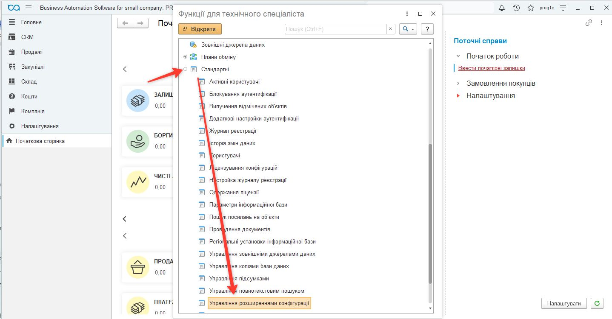
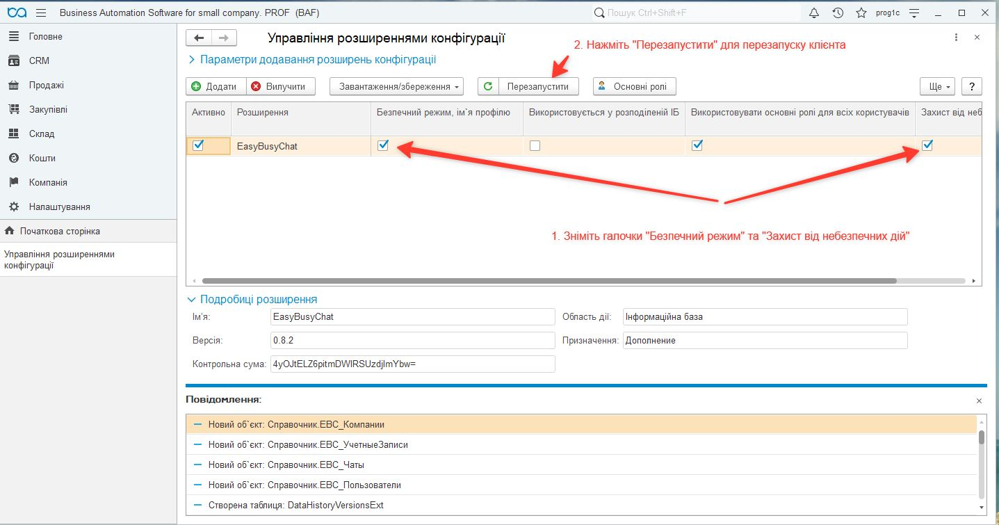
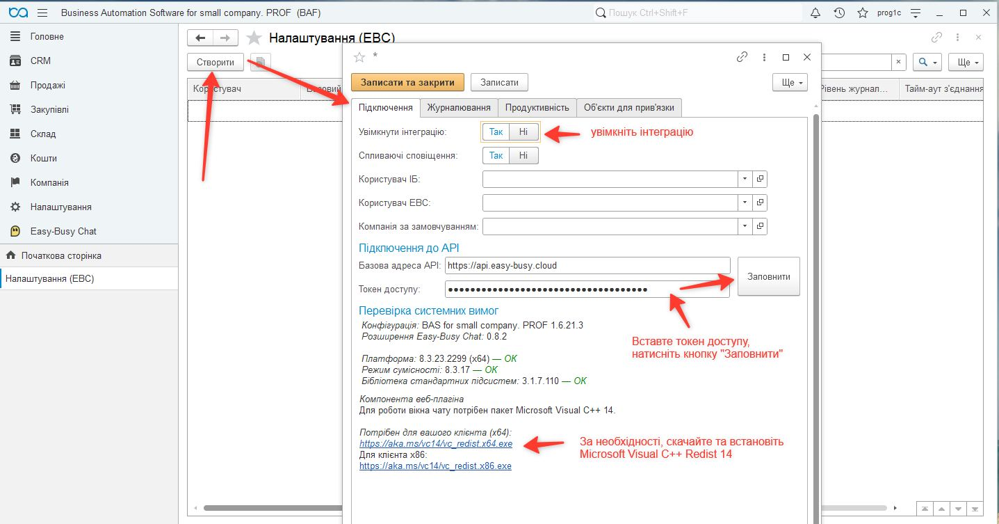
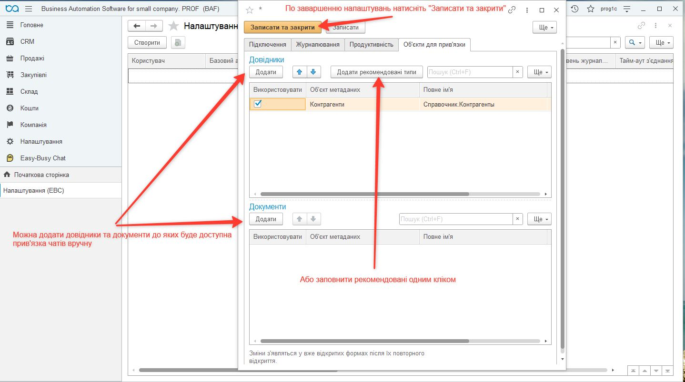
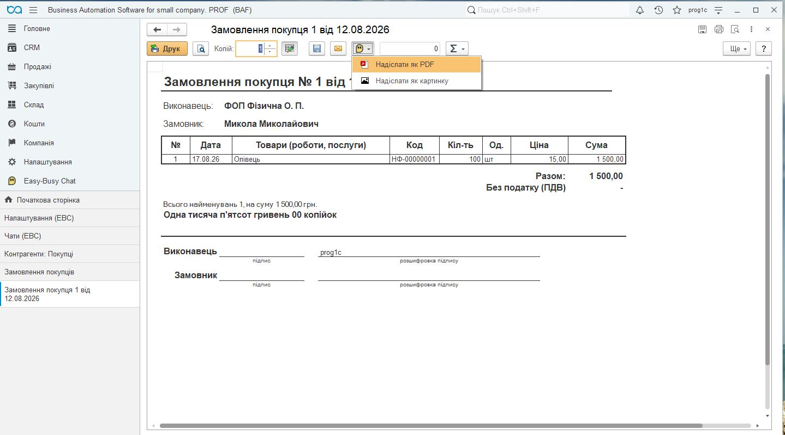

[Українська](README.md) · [**Русский**](README_ru.md)

  

# Easy Busy Chat для BAS / BAF

Расширение интегрирует конфигурации 1С/BAF (BAS) с сервисом **Easy-Busy Chats** без изменения основной конфигурации. Оно помогает работать с перепиской из мессенджеров в контексте клиентов и документов учётной базы.

Этот документ описывает выбор расширения, установку, настройку и ежедневную работу. Репозиторий содержит готовые CFE-расширения, дополнительную EPF-обработку, ZIP-комплекты и документацию.

## Содержание

- [Возможности](#capabilities)
- [Скачать и выбрать вариант](#downloads)
- [Системные требования](#requirements)
- [Установка](#installation)
- [Первоначальная настройка](#setup)
- [Работа с чатами](#usage)
- [Фоновые задания для 8.3.19](#scheduler)
- [Обновление расширения](#updating)
- [Проверка настройки](#verification)
- [Решение проблем](#troubleshooting)
- [Состав репозитория](#repository)

## Возможности

- Синхронизация компаний, аккаунтов, пользователей и чатов Easy-Busy Chats.
- Связи чатов со справочниками и документами информационной базы.
- Открытие вебчата, отправка текстовых сообщений и печатных форм как PDF или изображения.
- Поиск чатов по международному номеру телефона и создание чатов Viber, WhatsApp и Telegram, если это позволяет аккаунт.
- Выбор языка чата, журналирование действий пользователей и технических событий интеграции.
- Рабочее место «Контакт-центр» в вариантах EasyBusyChat для BAS Малий бізнес.
- Регламентная синхронизация и очистка журнала; для отдельного варианта 8.3.19 — через дополнительную обработку БСП.

Доступные каналы и возможность начать переписку зависят от провайдера и прав аккаунта. Принятие сообщения сервисом не является подтверждением доставки получателю.

## Скачать и выбрать вариант

Проверьте конфигурацию и версию платформы в меню «О программе». Устанавливайте **один** из трёх альтернативных вариантов CFE.

| Вариант | Когда выбирать | Загрузка |
|---|---|---|
| **EasyBusyChat** | BAS Малий бізнес 1.6 / 2.0 на платформе новее 8.3.19; включает «Контакт-центр» | [ZIP с инструкцией](releases/2026-11-02/EasyBusyChat_v0.10.5.zip?raw=1) · [CFE](releases/2026-11-02/EasyBusyChat_v0.10.5.cfe?raw=1) |
| **EasyBusyChat 8.3.19** | BAS Малий бізнес 1.6 / 2.0 на платформе 8.3.19; включает «Контакт-центр»; обязательный комплект **CFE + EPF** | [ZIP-комплект](releases/2026-11-02/EasyBusyChat_8.3.19_v0.10.4.zip?raw=1) · [CFE](releases/2026-11-02/EasyBusyChat_8.3.19_v0.10.4.cfe?raw=1) · [EPF](releases/2026-11-02/EasyBusyChatScheduler8319.epf?raw=1) |
| **EasyBusyChat Universal** | Базовая интеграция без «Контакт-центра» для поддерживаемых конфигураций на платформе новее 8.3.19 | [ZIP с инструкцией](releases/2026-11-02/EasyBusyChatUniversal_v0.10.4.zip?raw=1) · [CFE](releases/2026-11-02/EasyBusyChatUniversal_v0.10.4.cfe?raw=1) |

**Поддерживаемые конфигурации:**

| Конфигурация | EasyBusyChat / EasyBusyChat 8.3.19 | Universal |
|---|---|---|
| BAS Малий бізнес 1.6 / 2.0 | Да | Да |
| BAS Управління торгівлею 3.5 | — | Да |
| BAS Комплексне управління підприємством 3.5 | — | Да |
| BAS ERP 2.5 | — | Да |

ZIP нужно распаковать перед установкой. Каждый архив содержит CFE, инструкцию на украинском языке и контрольные суммы SHA-256. Комплект 8.3.19 дополнительно содержит EPF и её инструкцию. [Контрольные суммы файлов](releases/2026-11-02/SHA256SUMS.txt).

Для BAS Малий бізнес на платформе 8.3.19 выбирайте именно комплект 8.3.19 и настройте [фоновые задания БСП](#scheduler). Название этого варианта обозначает платформу, а не режим совместимости расширения.

## Системные требования

| Компонент | Требование |
|---|---|
| Платформа 1С/BAF | 8.3.19.1529 или новее, с учётом выбора варианта выше |
| Библиотека стандартных подсистем (БСП) | 3.1 или новее |
| Режим совместимости EasyBusyChat и варианта 8.3.19 | 8.3.17 |
| Режим совместимости Universal | 8.3.14 |
| Вебкомпонента | Тонкий или толстый клиент Windows x86/x64 |
| Среда вебкомпоненты | Microsoft Edge WebView2 Runtime на рабочем месте пользователя |
| Сеть | HTTPS-доступ к API Easy-Busy Chats и связанным вебресурсам |
| Доступ к сервису | Адрес API, токен и права соответствующего аккаунта |
| Установка | Администратор информационной базы или пользователь с полными правами |

[Скачать WebView2 Runtime с сайта Microsoft](https://developer.microsoft.com/en-us/microsoft-edge/webview2/#download-section). Используйте Evergreen Runtime; для установки без интернета есть Standalone Installer.

Отдельное окно вебчата предназначено для Windows-клиента. Расширение содержит Native API-компоненты x86 и x64, архитектуру выбирает платформа. В вебклиенте чат открывается по ссылке в браузере. Работу остальных сценариев в конкретном клиенте и ОС нужно проверить в своей базе.

## Установка

Названия команд зависят от редакции BAS и языка интерфейса. Существующие скриншоты помогают найти нужные формы; их вид может отличаться.

1. Сделайте резервную копию базы и сначала проверьте установку в тестовой копии. Выберите пакет по таблице, распакуйте ZIP и сверьте контрольную сумму.
2. Установите WebView2 Runtime на рабочих местах Windows, где будет использоваться вебплагин.
3. Войдите в базу в режиме «1С:Предприятие» с административными правами. Откройте **Настройки → Параметры** и включите **«Режим технического специалиста»**.
4. Откройте **Функции для технического специалиста → Стандартные → Управление расширениями конфигурации**.
5. Нажмите **«Добавить»**, выберите CFE и подтвердите открытие проверенного файла. Если после первого подтверждения расширение не появилось, повторите добавление.
6. Для работы внешней Native API-компоненты у доверенного **CFE-расширения** снимите флажки **«Безопасный режим»** и **«Защита от опасных действий»**. Это разрешение на запуск внешней компоненты; оно не является инструкцией отключать безопасный режим EPF.
7. Перезапустите клиент. Назначьте пользователям роли Easy Busy Chat в соответствии с их обязанностями.
8. Выполните первоначальную настройку ниже. Для варианта 8.3.19 дополнительно зарегистрируйте EPF и расписания БСП.

Если расширение уже установлено, используйте [процедуру обновления](#updating), а не добавление другого варианта.

## Первоначальная настройка

### Подключение к сервису

1. Откройте **Easy-Busy Chats → Администрирование → Настройки** и нажмите **«Создать»**.
2. Включите интеграцию. Укажите базовый адрес API, если он не заполнен, и свой токен доступа.
3. Нажмите **«Обновить идентификаторы»** под полем токена. Проверьте загруженные компании, аккаунты и пользователей.
4. При необходимости выберите пользователя информационной базы, пользователя EBC и компанию по умолчанию.
5. Выберите язык чата, сохраните настройки и заново откройте чат. Команды «Открыть контакт» и «Создать заказ» используют выбранный язык.

Токен храните в настройках базы. Не добавляйте его в документацию, сообщения и скриншоты.

### Журналирование и права

На вкладке **«Журналирование»** включите нужные технические события и действия пользователей, определите минимальный уровень и количество дней хранения записей. Срок хранения согласуйте с администратором.

Проверьте права пользователей на подсистему и нужные операции. Не назначайте всем пользователям полные административные права для обычной работы с чатами.

### Объекты для привязки

1. На вкладке **«Объекты для привязки»** добавьте справочники и документы кнопкой **«Добавить»** или **«Добавить рекомендованные типы»**.
2. Для нужных типов включите **«Использовать»**.
3. Нажмите **«Записать и закрыть»** и заново откройте формы объектов. Уже открытые формы не подхватывают команды автоматически.

## Работа с чатами

### Загрузка и поиск

Откройте **Easy-Busy Chats → См. также → Чаты**, нажмите **«Загрузить список»** и дождитесь завершения синхронизации.

Для поиска по телефону используйте международный формат номера. Создание чата Viber, WhatsApp или Telegram доступно только тогда, когда соответствующий провайдер и аккаунт позволяют начать переписку.

### Связи с клиентами и документами

В формах настроенных справочников и документов появляется подменю **Easy-Busy Chats**. Доступность команд зависит от контекста:

- **«Открыть чат»** — перейти к переписке.
- **«Привязанные чаты»** — просмотреть, создать или изменить связь объекта с чатом.
- **«Отправить сообщение»** — отправить текст в выбранный чат.

Проверяйте связи объекта и получателя перед отправкой, особенно если к объекту привязано несколько чатов.

### Печатные формы

В предварительном просмотре печатной формы используйте **«Отправить как PDF»** или **«Отправить как картинку»**. Убедитесь, что выбраны нужные документ и чат.

### Контакт-центр

Варианты EasyBusyChat для BAS Малий бізнес включают рабочее место **«Контакт-центр»**. Universal предназначен для базовой интеграции без этого рабочего места. Доступ определяется установленным вариантом и правами пользователя.

## Фоновые задания для 8.3.19

Этот раздел относится к комплекту **EasyBusyChat 8.3.19 + EasyBusyChatScheduler8319.epf** для BAS Малий бізнес. EPF вызывает серверные процедуры расширения через БСП; отдельной пользовательской формы у неё нет.

### Регистрация обработки

1. Установите CFE, перезапустите клиент и настройте API.
2. В настройках администрирования BAS включите **«Дополнительные отчёты и обработки»** и добавьте EPF из файла. Названия разделов зависят от редакции BAS и БСП.
3. Проверьте наличие обработки **«EasyBusyChat: фоновые операции (8.3.19)»** и трёх команд из таблицы.
4. Проверьте разрешение безопасного режима EPF на HTTPS к `api.easy-busy.cloud:443`. Для другого адреса API требуется отдельная доработка разрешения в EPF. **Не отключайте безопасный режим EPF как способ обхода ошибки.**
5. Для каждой команды отдельно включите использование, задайте расписание и сохраните карточку. Само добавление EPF не включает выполнение по расписанию.

### Команды и начальные расписания

| Операция | Идентификатор БСП | Назначение | Рекомендуемое расписание |
|---|---|---|---|
| Синхронизация чатов | `EBC_СинхронизацияЧатов` | Чаты и последние сообщения | Каждую минуту, повторение через 60 секунд |
| Синхронизация справочников | `EBC_СинхронизацияСправочников` | Компании, аккаунты, пользователи | Каждые 15 минут, повторение через 900 секунд |
| Ротация журнала | `EBC_РотацияЛогов` | Удаление записей по сроку хранения | Ежедневно в 03:00, один запуск |

Расписания настраиваются вручную. 03:00 — время информационной базы или сервера выполнения; выберите время, которое не пересекается с обслуживанием базы. В файловой базе нужен активный сеанс, обслуживающий фоновые задания: EPF не обеспечивает их выполнение, когда все клиенты закрыты. В серверной базе проверьте, что регламентные задания не заблокированы.

Сначала запустите вручную синхронизацию справочников, затем чатов. Ротацию запускайте после проверки срока хранения. Просмотрите историю выполнения БСП, журнал регистрации и журнал EBC, дождитесь запусков по расписанию и проверьте время следующего выполнения.

Если синхронизация длится дольше интервала или API отвечает `429`, увеличьте интервал чатов до 2–5 минут; при необходимости справочников — до 30–60 минут. Не запускайте одну операцию параллельно или через два механизма расписания. Успешный статус задания может сопровождаться частичной синхронизацией — проверяйте предупреждения журнала EBC.

## Обновление расширения

1. Сделайте резервную копию и проверьте обновление в тестовой базе.
2. Выберите тот же вариант расширения, который уже используется. Universal не является автоматической заменой основного EasyBusyChat.
3. Выполните **обновление существующего расширения**, не удаляя его: удаление может повлиять на данные расширения.
4. Перезапустите клиент и проверьте настройки API, права, связи чатов и работу команд.
5. Для варианта 8.3.19 проверьте EPF и три отдельных расписания.

Первичная миграция старых связей выполняется порциями и на большой базе может занять больше времени. После обновления проверьте сохранение связей и результаты синхронизации.

## Проверка настройки

- Расширение активно, клиент перезапущен, подсистема Easy-Busy Chats доступна нужным пользователям.
- Компании, аккаунты, пользователи и список чатов загружаются.
- В выбранных справочниках и документах появились команды, связи ведут к нужным чатам.
- Вебчат открывается в соответствующем клиенте.
- Тестовое сообщение и печатная форма отправляются в согласованный тестовый чат.
- В журнале нет повторяющихся ошибок; для комплекта 8.3.19 выполняются все три задания БСП.

## Решение проблем

| Проблема | Что проверить |
|---|---|
| Нет подсистемы Easy-Busy Chats | Активность расширения, перезапуск клиента, роли пользователя |
| Не открывается вебчат или Native API-компонента | Windows-клиент, WebView2 Runtime, разрешения доверенного CFE, журнал регистрации |
| Не загружаются компании или пользователи | Адрес API, действительность и права токена, HTTPS-доступ |
| Нет команд в справочнике или документе | Тип объекта в привязках, флажок «Использовать», сохранение настроек, повторное открытие формы |
| Не синхронизируются чаты | Аккаунт, токен, доступ к API, журнал EBC |
| Сообщение попадает не в тот чат | Связи объекта и основной привязанный чат |
| Нет трёх команд БСП | Файл EPF и совместимость БСП |
| Не найден метод или модуль EBC | Активность нужного CFE и перезапуск клиента |
| У EPF нет доступа к API | Разрешение на адрес API, HTTPS-доступ и токен; безопасный режим EPF не отключайте |
| Расписание есть, запусков нет | Использование команды, блокировки заданий, активный сеанс файловой базы |
| Задание завершилось, но обновлена часть данных | Предупреждения и ошибки журнала EBC |

Для разбора проблемы сохраните текст ошибки, время события и версии платформы, конфигурации и расширения. Не включайте в диагностические материалы токены и конфиденциальные данные клиентов.

## Состав репозитория

- [README.md](README.md) — это руководство на украинском языке.
- `README_ru.md` — то же руководство на русском языке.
- `releases/` — готовые CFE, EPF, ZIP-комплекты и контрольные суммы.
- `doc/img/` — изображения для документации.
- Документация на русском в `doc_ru/`: [пошаговая установка со скриншотами](doc_ru/instruction_ru.md), [краткая настройка](doc_ru/quick-start_ru.md), [совместимость](doc_ru/compatibility_ru.md), [настройка БСП](doc_ru/scheduler-8319_ru.md), [версии и архив](doc_ru/versions_ru.md).

XML/BSL-выгрузки и архивы исходных файлов не входят в описанные комплекты.

[EasyBusy](https://easy-busy.ua/) · [Українська](README.md) · [Русский](README_ru.md)
