[Украинский оригинал](../doc/instruction_uk.md) · [Главная](../README_ru.md)

# Установка и первоначальная настройка Easy Busy Chat для 1С/BAF (BAS)

> Инструкция для выпуска от **02.11.2026**: МБ **0.10.5**, 8.3.19 и Universal **0.10.4**. Скриншоты иллюстрируют предыдущую версию; расположение команд может отличаться. [Краткая настройка](quick-start_ru.md) · [БСП для 8.3.19](scheduler-8319_ru.md).

## Содержание

1. [Об Easy Busy Chat](#about)
2. [Системные требования](#requirements)
3. [Поддерживаемые конфигурации и выбор расширения](#configurations)
4. [Возможности в разных клиентах и операционных системах](#clients)
5. [Подготовка к установке](#preparation)
6. [Установка расширения](#installation)
7. [Первоначальная настройка](#initial-setup)
8. [Загрузка чатов](#load-chats)
9. [Работа с чатами в справочниках и документах](#usage)
10. [Проверка после установки](#checklist)
11. [Типичные проблемы](#troubleshooting)

---

## Об Easy Busy Chat

**EasyBusy Chats** — украинский омниканальный AI-центр чатов для бизнеса. Он объединяет сообщения из Telegram, WhatsApp, Viber, Instagram и других каналов в одном рабочем пространстве, помогает быстрее отвечать клиентам, уменьшать потери обращений и работать с инструментами экосистемы EasyBusy CRM.

Расширение **Easy Busy Chat для 1С/BAF (BAS)** добавляет в учётную систему:

- синхронизацию компаний, аккаунтов, пользователей и чатов;
- связи чатов со справочниками и документами информационной базы;
- открытие вебокна чата в тонком или толстом клиенте Windows;
- отправку текстовых сообщений и печатных форм в чат;
- журналирование действий и технических событий интеграции;
- рабочее место **«Контакт-центр»** в полной версии `EasyBusyChat_v0.10.5.cfe` для BAS Малий бізнес.

---

## Системные требования

| Компонент | Требование |
|---|---|
| Платформа 1С/BAF | **8.3.19.1529 или новее**; для ветки 8.3.19 нужен отдельный комплект CFE + EPF БСП |
| Режим совместимости расширения `EasyBusyChat` | **8.3.17** |
| Режим совместимости расширения `EasyBusyChatUniversal` | **8.3.14** |
| Библиотека стандартных подсистем (БСП) | **3.1 или новее** |
| Вебкомпонента Easy Busy Chat | Windows x86/x64, тонкий или толстый клиент 1С/BAF |
| Компонент вебплагина | Обязательно **[Microsoft Edge WebView2 Runtime](https://developer.microsoft.com/en-us/microsoft-edge/webview2/#download-section)** на рабочем месте Windows |
| Доступ к сети | HTTPS-доступ к API Easy Busy Chat и связанным вебресурсам |
| Права на установку | Администратор информационной базы или пользователь с полными правами |

> **Рекомендация.** Перед установкой обновите платформу до проверенной версии и создайте резервную копию информационной базы. Сначала выполните установку в тестовой копии базы.

---

## Поддерживаемые конфигурации и выбор расширения

Для текущего выпуска сохранена поддержка следующих конфигураций; см. [матрицу совместимости](compatibility_ru.md):

- BAS Малий бізнес 1.6;
- BAS Малий бізнес 2.0;
- BAS Управління торгівлею 3.5;
- BAS Комплексне управління підприємством 3.5;
- BAS ERP 2.5.

**Для BAS Малий бізнес 1.6 / 2.0 с «Контакт-центром» на платформе 1С/BAF 8.3.19 устанавливайте `EasyBusyChat_8.3.19_v0.10.4.cfe` и обязательно `EasyBusyChatScheduler8319.epf` для регламентных заданий БСП.** [Настройка комплекта](scheduler-8319_ru.md).

Для более новой платформы выберите файл в соответствии с конфигурацией и нужными возможностями:

| Файл | Когда использовать |
|---|---|
| `EasyBusyChat_v0.10.5.cfe` | Для **BAS Малий бізнес**. Содержит полный функционал, включая дополнительную обработку — рабочее место **«Контакт-центр»** |
| `EasyBusyChatUniversal_v0.10.4.cfe` | Для других поддерживаемых конфигураций или когда достаточно базовых возможностей интеграции без рабочего места «Контакт-центр» |

> **Важно.** Перед обновлением или установкой в рабочей базе проверьте примечания к конкретному выпуску расширения и совместимость с вашей редакцией конфигурации.

---

## Возможности в разных клиентах и операционных системах

Полноценное отдельное окно вебчата работает в **тонком и толстом клиенте 1С/BAF под Windows**. Расширение содержит оба варианта Native API-компоненты — x86 и x64; нужную архитектуру платформа выбирает автоматически.

В вебклиенте чат открывается по ссылке в браузере. Внешняя Windows-компонента вебчата предназначена для клиента Windows. Приведённые ниже сценарии не требуют отдельного окна вебчата, однако их работу в каждом клиенте и ОС для текущего выпуска ещё нужно проверить:

- просмотр и синхронизация списка чатов;
- создание, изменение и удаление связей чатов с объектами базы;
- отправка текстовых сообщений;
- отправка печатных форм в поддерживаемых форматах.

---

## Подготовка к установке

### Шаг 1. Проверьте совместимость и создайте резервную копию

[Скачайте ZIP нужного варианта](../README_ru.md#downloads) и распакуйте его. Для каждого варианта включена украинская инструкция; для 8.3.19 — также EPF и инструкция БСП. Отдельные CFE и EPF остаются доступными в репозитории.

Убедитесь, что конфигурация, платформа и версия БСП соответствуют [системным требованиям](#requirements). Сделайте резервную копию информационной базы и скачайте нужный пакет: для платформы 8.3.19 — `EasyBusyChat_8.3.19_v0.10.4.cfe` и `EasyBusyChatScheduler8319.epf`; для более новой платформы — `EasyBusyChat_v0.10.5.cfe` или `EasyBusyChatUniversal_v0.10.4.cfe` в соответствии с конфигурацией.

### Шаг 2. Войдите с правами администратора

Запустите базу в режиме **1С:Предприятие** под пользователем с полными административными правами.

Откройте главное меню и выберите **Настройки → Параметры**.

  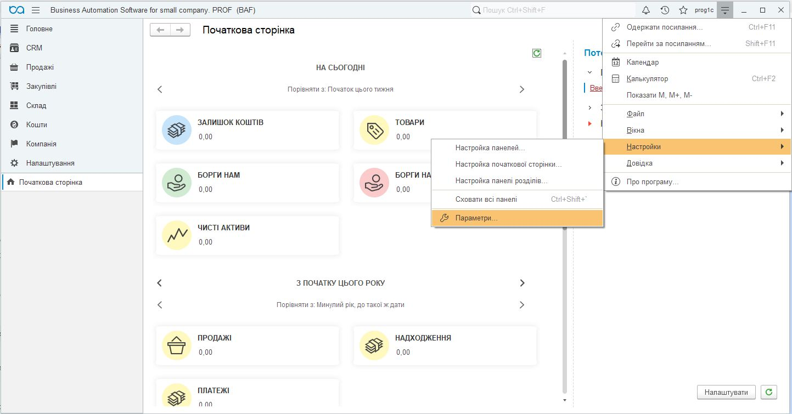

<em>Рисунок 1 — Переход к параметрам программы</em>

Установите флажок **«Режим технического специалиста»** и нажмите **OK**.

  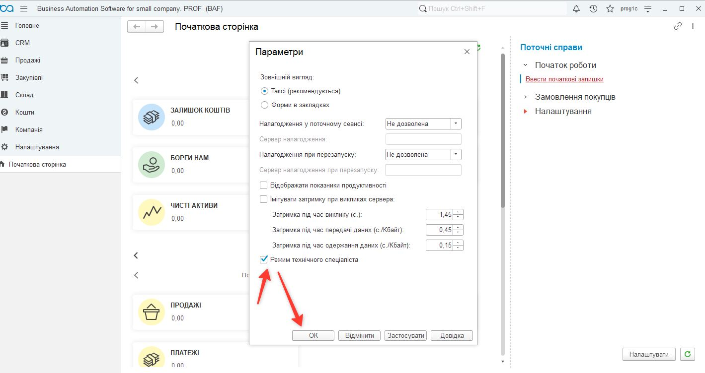

<em>Рисунок 2 — Включение режима технического специалиста</em>

### Шаг 3. Откройте управление расширениями

В главном меню выберите **«Функции для технического специалиста…»**.

  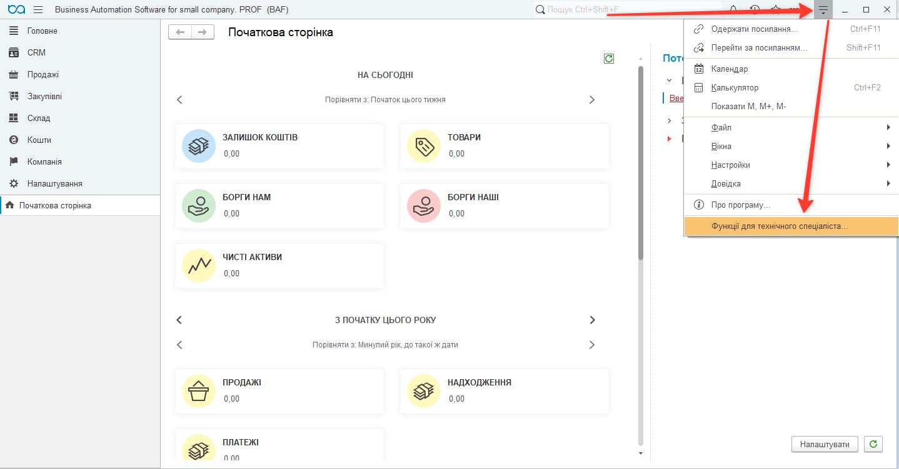

<em>Рисунок 3 — Открытие функций для технического специалиста</em>

В разделе **«Стандартные»** откройте **«Управление расширениями конфигурации»**.

  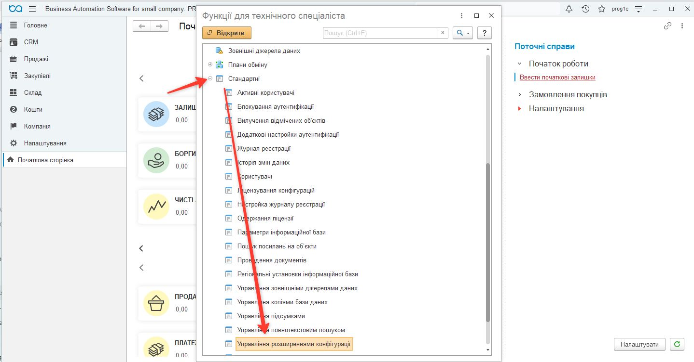

<em>Рисунок 4 — Команда «Управление расширениями конфигурации»</em>

---

## Установка расширения

### Шаг 4. Добавьте файл расширения

В форме **«Управление расширениями конфигурации»** нажмите **«Добавить»**, выберите нужный CFE-файл и нажмите **«Открыть»**:

- `EasyBusyChat_8.3.19_v0.10.4.cfe` — для BAS Малий бізнес 1.6 / 2.0 с «Контакт-центром» на платформе 1С/BAF 8.3.19; после установки также подключите [EPF БСП](scheduler-8319_ru.md);
- `EasyBusyChat_v0.10.5.cfe` — для BAS Малий бізнес с рабочим местом «Контакт-центр» на более новой платформе;
- `EasyBusyChatUniversal_v0.10.4.cfe` — для других поддерживаемых конфигураций или базового варианта интеграции.

  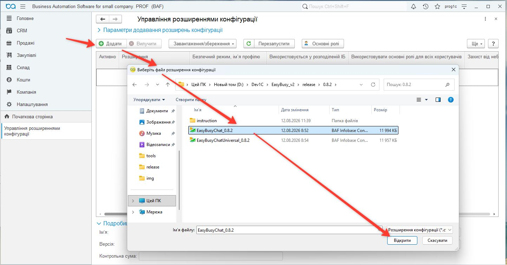

<em>Рисунок 5 — Добавление CFE-файла в информационную базу</em>

### Шаг 5. Подтвердите открытие файла

Если появится предупреждение безопасности, проверьте источник файла и нажмите **«Да»**, чтобы разрешить его открытие.

  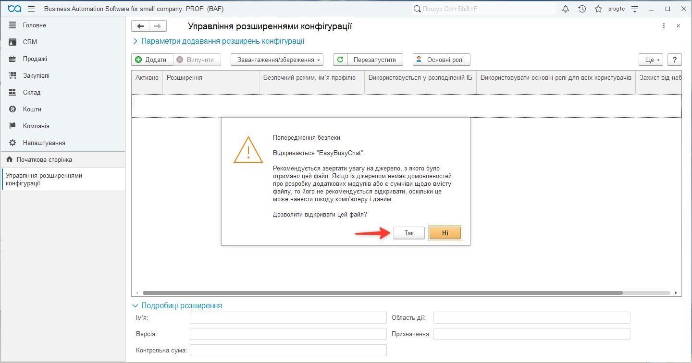

<em>Рисунок 6 — Подтверждение открытия файла расширения</em>

> Разрешайте открытие только файла, полученного из доверенного источника. Если поставщик публикует контрольную сумму или цифровую подпись, проверьте их перед установкой.

### Шаг 6. При необходимости повторите добавление

В некоторых версиях платформы после первого подтверждения безопасности нужно ещё раз нажать **«Добавить»** и повторно выбрать CFE-файл. После успешной загрузки расширение появится в списке.

  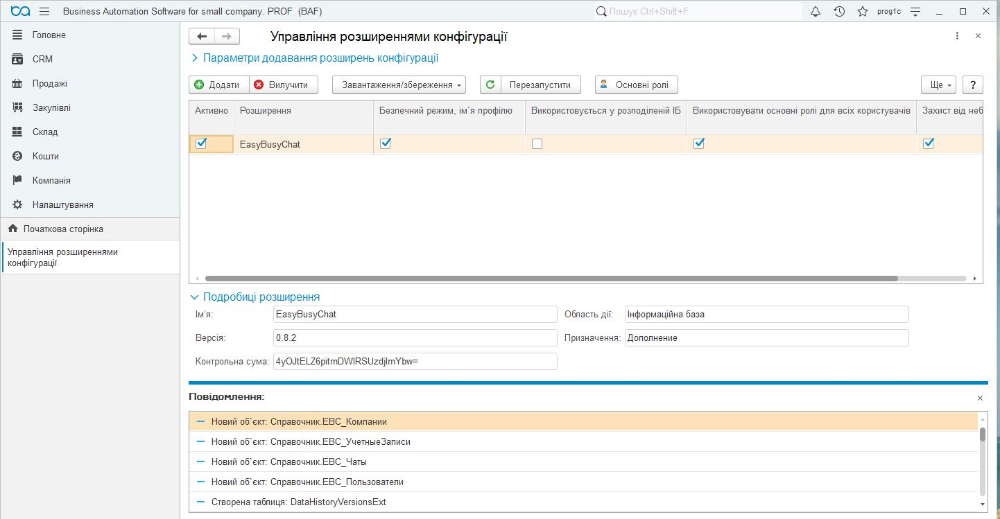

<em>Рисунок 7 — Расширение EasyBusyChat в списке установленных расширений</em>

### Шаг 7. Настройте безопасность и перезапустите клиент

Для работы Native API-компоненты вебчата снимите для расширения флажки:

- **«Безопасный режим»**;
- **«Защита от опасных действий»**.

После этого нажмите **«Перезапустить»** и подтвердите перезапуск клиента.

  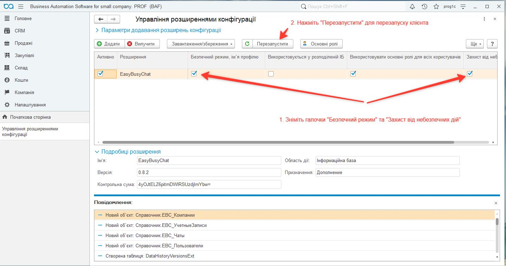

<em>Рисунок 8 — Параметры безопасности, необходимые для работы вебкомпоненты</em>

> **Предупреждение о безопасности.** Снятие этих флажков позволяет расширению запускать внешнюю компоненту. Выполняйте это действие только для проверенного CFE-файла. Не назначайте всем пользователям основные роли автоматически без оценки прав доступа; назначайте роли Easy Busy Chat в соответствии с обязанностями пользователей.

---

## Первоначальная настройка

### Шаг 8. Откройте настройки Easy Busy Chat

После перезапуска в меню появится подсистема **«Easy-Busy Chats»**. Перейдите в **Easy-Busy Chats → Администрирование → Настройки**.

  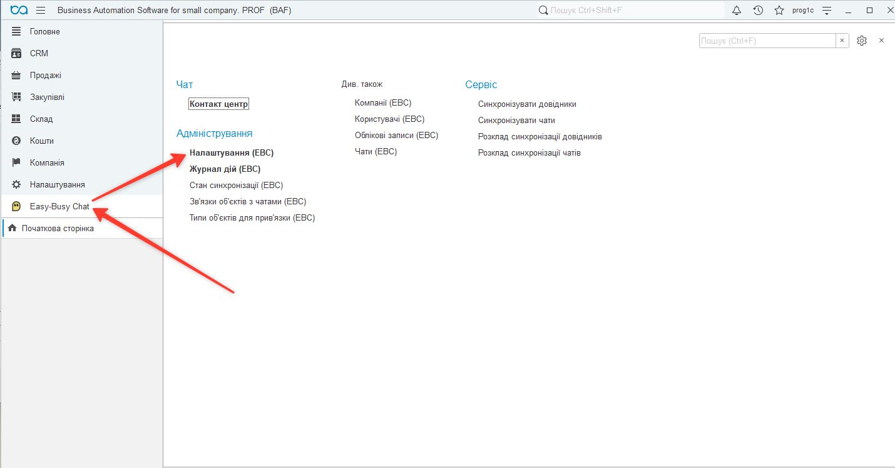

<em>Рисунок 9 — Переход к первоначальным настройкам интеграции</em>

### Шаг 9. Создайте настройки и подключите API

1. Нажмите **«Создать»**.
2. Включите интеграцию.
3. Укажите базовый адрес API, если он не заполнен автоматически.
4. Вставьте токен доступа Easy Busy Chat.
5. Нажмите **«Обновить идентификаторы»** под полем токена доступа.

Расширение проверит соединение и загрузит доступные компании, аккаунты и пользователей. При необходимости выберите пользователя информационной базы, пользователя EBC и компанию по умолчанию.

  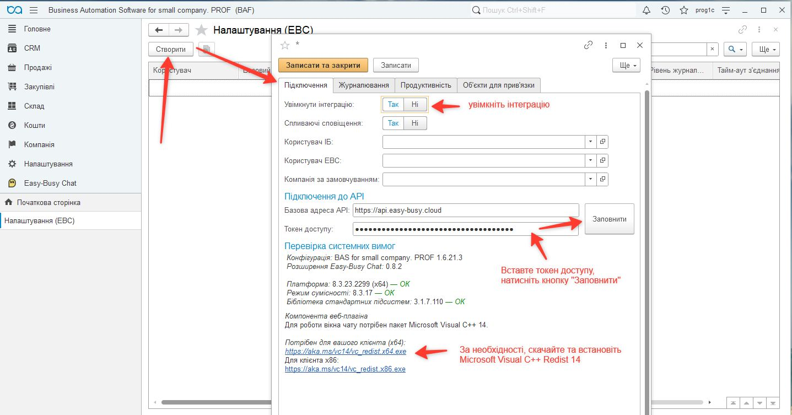

<em>Рисунок 10 — Подключение к API и первоначальная загрузка справочников</em>

Для работы вебплагина нужен **Microsoft Edge WebView2 Runtime**. [Скачайте Evergreen Runtime с официального сайта Microsoft](https://developer.microsoft.com/en-us/microsoft-edge/webview2/#download-section), установите и перезапустите клиент.

> Не публикуйте токен доступа в переписке, документах или скриншотах. Храните его как секрет и замените, если он мог попасть к посторонним.

Выберите язык чата в настройках, сохраните их и заново откройте чат. Команды «Открыть контакт» и «Создать заказ» используют выбранный язык.

### Шаг 10. Настройте журналирование

На вкладке **«Журналирование»** определите:

- нужно ли журналировать технические события;
- нужно ли журналировать действия пользователей;
- минимальный уровень журналирования;
- количество дней хранения журнала.

Для рабочей базы рекомендуется согласовать срок хранения журнала с администратором и требованиями вашей организации.

  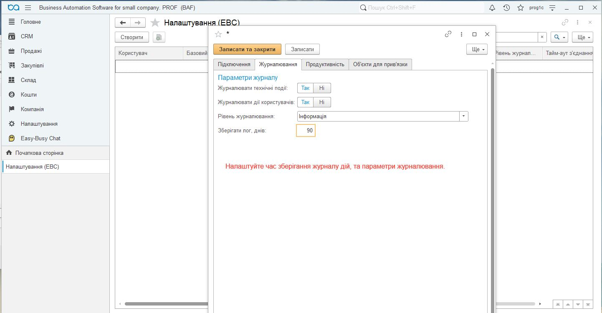

<em>Рисунок 11 — Параметры журналирования и срок хранения записей</em>

### Шаг 11. Выберите объекты для привязки чатов

На вкладке **«Объекты для привязки»** добавьте справочники и документы, с которыми нужно связывать чаты или из которых нужно отправлять сообщения и печатные формы.

Список можно сформировать двумя способами:

- добавить нужные типы вручную кнопкой **«Добавить»**;
- нажать **«Добавить рекомендованные типы»**, чтобы заполнить типовой набор одним кликом.

Проверьте флажок **«Использовать»** для каждого нужного типа и нажмите **«Записать и закрыть»**.

  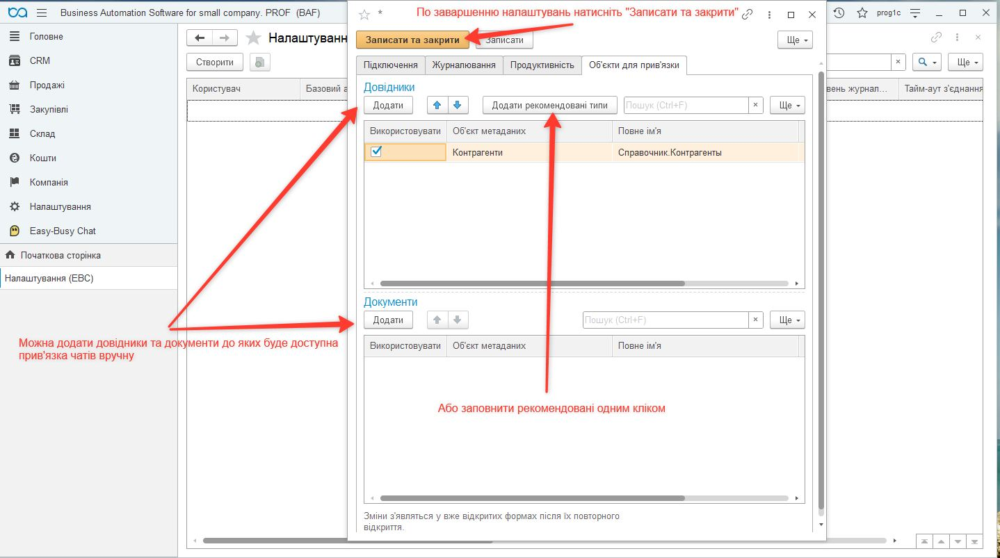

<em>Рисунок 12 — Настройка объектов, доступных для связи с чатами</em>

> Команды Easy Busy Chat появятся в формах, которые уже были открыты, только после их повторного открытия.

---

## Загрузка чатов

### Шаг 12. Синхронизируйте список чатов

Перейдите в **Easy-Busy Chats → См. также → Чаты**.

  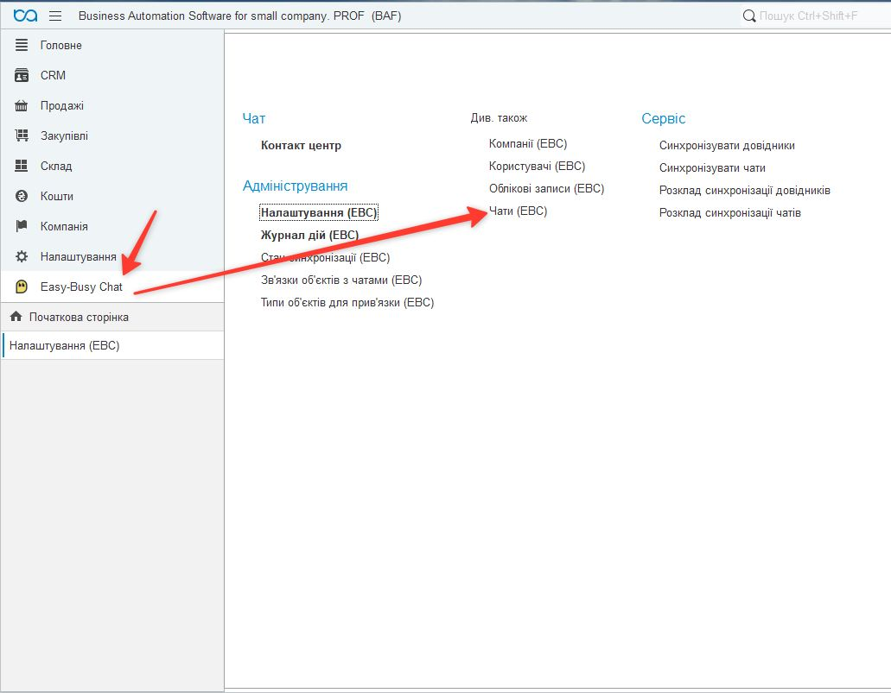

<em>Рисунок 13 — Открытие списка чатов Easy Busy Chat</em>

В форме списка нажмите **«Загрузить список»** и дождитесь завершения синхронизации.

  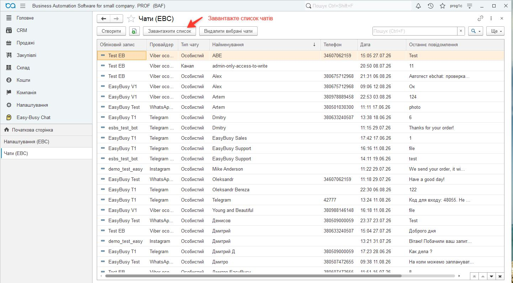

<em>Рисунок 14 — Загрузка актуального списка чатов</em>

---

## Работа с чатами в справочниках и документах

### Шаг 13. Используйте команды Easy Busy Chat

В формах подключённых справочников и документов появится подменю **Easy-Busy Chats**. В зависимости от контекста оно содержит команды:

- **«Открыть чат»**;
- **«Привязанные чаты»** — просмотр, создание или изменение связи;
- **«Отправить сообщение»**.

  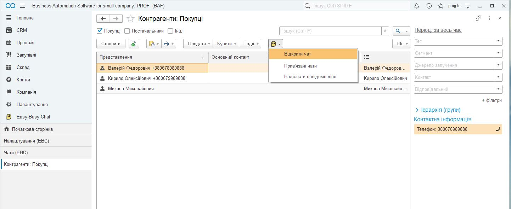

<em>Рисунок 15 — Команды Easy Busy Chat в списке контрагентов</em>

  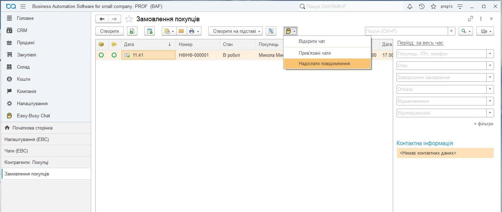

<em>Рисунок 16 — Команды Easy Busy Chat в списке документов</em>

В форме предварительного просмотра печатной формы доступны команды:

- **«Отправить как PDF»**;
- **«Отправить как картинку»**.

Перед отправкой убедитесь, что документ связан с нужным чатом и печатная форма не содержит данных, которые нельзя передавать получателю.

  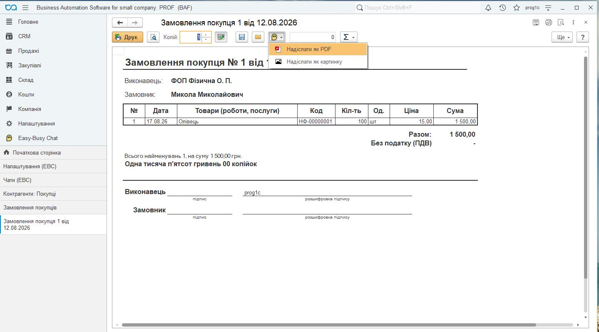

<em>Рисунок 17 — Отправка печатной формы как PDF или изображения</em>

---

## Проверка после установки

После завершения настройки проверьте:

- [ ] расширение активно и клиент 1С/BAF перезапущен;
- [ ] подсистема **«Easy-Busy Chats»** отображается в меню;
- [ ] интеграция включена, токен принят без ошибок;
- [ ] компании, аккаунты и пользователи EBC загрузились;
- [ ] список чатов синхронизируется;
- [ ] команды Easy Busy Chat появились в выбранных справочниках и документах;
- [ ] в Windows-клиенте открывается окно вебчата;
- [ ] тестовое текстовое сообщение отправляется в правильный чат;
- [ ] тестовая печатная форма отправляется как PDF или изображение;
- [ ] пользователям назначены только необходимые роли;
- [ ] в журнале действий нет повторяющихся ошибок подключения или синхронизации.

---

## Типичные проблемы

| Проблема | Что проверить |
|---|---|
| Подсистема не появилась после установки | Активно ли расширение; выполнен ли перезапуск; есть ли у пользователя нужные роли |
| Не открывается вебокно чата | Проверьте Windows-клиент, установите **[Microsoft Edge WebView2 Runtime](https://developer.microsoft.com/en-us/microsoft-edge/webview2/#download-section)** и перезапустите BAS/BAF. Проверьте разрешения Native API-компоненты и журнал регистрации |
| Не удалось подключить Native API-компоненту | Убедитесь, что для доверенного расширения отключены безопасный режим и защита от опасных действий; проверьте журнал регистрации |
| Не заполняются компании или пользователи | Проверьте базовый адрес API, действительность токена, HTTPS-доступ и права токена |
| Нет команд в форме справочника или документа | Добавьте тип на вкладке «Объекты для привязки», включите его, сохраните настройки и заново откройте форму |
| Не загружаются чаты | Проверьте аккаунт EBC, токен, доступ к API и журнал синхронизации |
| Сообщение или файл попадает не в тот чат | Перед отправкой проверьте связи объекта и основной привязанный чат |

Если проблема повторяется, сохраните текст ошибки, дату и время события, версию платформы, конфигурации и расширения. Не добавляйте в диагностические материалы токены доступа или конфиденциальные данные клиентов.

## Обновление и фоновые операции

Для обновления используйте обновление существующего расширения тем же вариантом, предварительно проверив копию базы. Не удаляйте расширение как способ обновления. Для отдельной поставки 8.3.19 подключите [EPF и расписания БСП](scheduler-8319_ru.md). Файл Universal не является заменой основного варианта без отдельной проверки.
